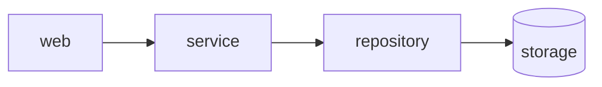

# Configuration and rules

[Documentation](README.md) · [Project overview](../README.md)

- [easement.yml](#easementyml)
- [Rules](#rules)
  - [Public API](#public-api)
  - [Named surfaces](#named-surfaces)
  - [Instances of one component](#instances-of-one-component)
  - [Slices](#slices)
  - [Who may import a component](#who-may-import-a-component)
  - [Layers and forbidden dependencies](#layers-and-forbidden-dependencies)
  - [Reaching through others](#reaching-through-others)
  - [External modules](#external-modules)
  - [Required imports and files](#required-imports-and-files)
  - [Files and directives](#files-and-directives)
  - [Symbols](#symbols)
  - [Tests](#tests)
  - [Coupling limits](#coupling-limits)
  - [Strict mode](#strict-mode)
  - [The diagram is the rule](#the-diagram-is-the-rule)
  - [Declared dependencies](#declared-dependencies)
  - [Names of types](#names-of-types)
  - [Unused files](#unused-files)
  - [Cycles](#cycles)
  - [Policy examples](#policy-examples)
  - [Warnings](#warnings)
  - [Suppressions](#suppressions)

## easement.yml

`easement.yml` lives in the project root; all paths are relative to it.

```yaml
version: 1

components:
  handler:    { in: internal/handlers }
  service:    { in: "internal/services/**" }
  repository: { in: "internal/domain/*/repository" }
  model:      { in: internal/models }

common: [model]

rules:
  handler: { may_depend_on: [service] }
  service:
    may_depend_on: [repository]
    because: services never talk HTTP

exclude: ["**/*_test.go"]
```

- **components**: an `in` pattern (a glob or a list of globs) names a module, whether it is a directory or a file: `src/app/cli` covers the `cli/` directory with everything below it and a file `cli.py`. `*` stays within one directory, `**` crosses directories. When several components match a file, the one with the higher `priority` wins (default 0), then the longest pattern, so a single file can be carved out of a larger component. `except` lists patterns a component gives up: its files matching them belong to the next component that matches, if any. `part` makes a component own a part of those files, such as the Cargo feature `feature/fake` (see `packages`).
- **owner**: who to ask about a component and its rules, such as `owner: "@acme/payments"`. It is printed under each violation the component's code raises, given in `--format json` as `owners` by component (look up a violation's `from`), and shown by `easement explain`.
- **optional**: every `in` pattern has to match a file, and one that matches nothing (a directory renamed, a typo, files that `exclude` or `.gitignore` hide) fails as `unmatched` at its line in `easement.yml`, so a boundary cannot vanish while the check stays green. `--diff` and `--scope` still report it, the baseline never accepts it, and it cannot be suppressed. `optional: true` lets a component be empty for now; the `tests` component of `tests: auto` is optional.
- **rules**: an allow-list. A component may depend on itself, on `common` components and on what `may_depend_on` lists — nothing else. `because` is printed with every violation of the rule, so the reader (or an agent) learns where the code should go instead.
- Files outside every component are not checked, unless `strict: true` turns them into `orphan` violations. External modules are checked only where a rule says so, see [External modules](#external-modules).
- **target_only**: globs of generated files that stay in the graph as targets but are never checked as sources. Components can own them (`web-generated: { in: src/generated }`), and rules can allow or forbid importing them (`must_not_depend_on: [web-generated]`); their own imports, symbol uses and directives are not checked. `exclude` wins when a file matches both, and then importing it fails.
- **exclude**: globs to skip, for the whole project. `.gitignore` is honoured and `node_modules` is always skipped. Excluded files are not checked at all, and a checked file that imports one fails as `excluded`, since no rule would see that dependency (an indexer has to index the excluded file to resolve the import; files that `.gitignore` hides are never read): generated code the project imports belongs in `target_only`, and hand-written code that only the rules should skip (such as `config/initializers`) in a component or in `unowned`. To hold tests to rules of their own, see [Tests](#tests).

## Rules

Every violation carries a rule id, used in the JSON report, the baseline and suppressions.

| Rule | Fails when |
|---|---|
| `dependency` | a component imports one that its `may_depend_on` does not list |
| `privacy` | a component imports a path of another component outside that component's `public` API |
| `cycle` | components covered by `no_cycles` depend on each other in a cycle |
| `external` | a component uses an external module its rule does not allow |
| `metric` | a component exceeds `max_fan_out` or `max_instability` |
| `orphan` | with `strict: true`, a checked file belongs to no component |
| `isolation` | an instance of an `isolated` component imports another instance, or an import crosses slices of a named placeholder |
| `required` | a directory of a component lacks an import, a file or a directive its rule requires |
| `file` | a component holds a file its `forbid_file` rule forbids |
| `symbol` | a component uses a name its `forbid_symbol` rule forbids, or one outside the `public_symbols` of another component |
| `suppression-reason` | an inline suppression has no reason |
| `unused-suppression` | an inline suppression matches no violation, or names a rule that cannot be suppressed (`dependency`, `privacy`, `external`, `isolation`, `symbol` and `excluded` can be) |
| `unmatched` | an `in` pattern of a component matches no file of the project, a `part` names no part the scan found, an `entry` pattern matches no file, or a `forbid_symbol` name can never fire |
| `excluded` | a component imports a file that `exclude` hides |
| `reach` | a component reaches one its `must_not_reach` names through a chain of imports |
| `unused` | with `entry`, a file of a component that no chain of imports from an entry reaches |
| `naming` | a component defines a type whose name another component's `defines` claims |
| `diagram` | a dependency between components has no arrow in the `diagram` |
| `undeclared` | with `manifests`, a file imports an external module the nearest manifest does not declare |
| `example` | a policy example in `examples` gets another decision than it expects, or names a path no component owns |

In `--format json` each violation carries `rule`, `file`, `line`, `from`, `to`, `target` and `message`, and, where they apply: `evidence`, every dependency behind it as `{file, line}`; `reexported_by`, for a name written through a module of another component that re-exports it, or through an alias another component defines, those components; `chain`, for a `reach` or a `cycle`, the shortest chain of dependencies that shows it as typed `hops` `{file, line, from_component, to_component}` (`null` for a file of no component), labelled `witness: shortest` because it is one chain among those that may exist; and `provenance`, where the policy writes the clause it breaks: the field path in the merged policy, such as `rules.web.must_not_depend_on[1]`, and the policy `input` that defines it, relative to the root (a file `extends` names, for one).

### Public API

```yaml
components:
  billing:
    in: src/billing
    public: [src/billing/index, src/billing/api]
    because: billing internals change without notice
```

Other components may import only the public paths (`src/billing/index.ts`, anything under `src/billing/api`); code inside `billing` reaches its own internals freely. A component without `public` is open, unless it declares [named surfaces](#named-surfaces).

### Named surfaces

```yaml
components:
  billing:
    in: src/billing
    public: src/billing/api
    surfaces:
      admin: { in: src/billing/admin, importers: [jobs], because: maintenance only }
```

A named surface opens part of a component to the components it lists, and to no others: `jobs` may import `src/billing/admin`, `checkout` only `src/billing/api`. Both still depend on `billing`, one component with one owner, one place in cycles and one set of metrics. The grants decide first, then `allow_importers`, then the surfaces: a path is open when it is in `public` or in a named surface that lists the importer. Otherwise the import fails as `privacy`, naming the surface and who may use it:

```text
src/checkout/cart.ts:1: checkout -> billing: src/billing/admin/refund.ts is billing's admin surface, open to jobs (written as src/billing/admin/refund.ts) [privacy]
```

A component with `surfaces` and no `public` has an empty public surface: only its named surfaces are open. A path in `public` and in a named surface is public; a path in several named surfaces is open to all their importers. Surface paths must lie inside the component's `in`, outside its `except`, and take no placeholders, and `importers` must name components, each also in `allow_importers` when the component has it. Test code obeys surfaces too: list `tests` where it needs one. `explain` lists the surfaces of a component, `why` says which of them a dependency may go through, and `propose` names the ones open to the proposing component when a path is outside them all (`public_surface` and `named_surfaces` in `--format json`).

### Instances of one component

```yaml
components:
  pages:
    in: "src/pages/*"
    isolated: true
    because: pages ship as separate bundles
```

Each directory that `src/pages/*` matches is an instance, and instances of an `isolated` component must not depend on each other: `src/pages/contacts` cannot depend on `src/pages/segments`. A file `contacts.tsx` and a directory `contacts/` are the same instance. Every `in` pattern of an isolated component needs a `*` or a [placeholder](#slices) to tell the instances apart, and no `**`. Violations are the `isolation` rule and can be suppressed inline; `because` of the component is printed with them.

### Slices

```yaml
components:
  ui:   { in: "src/features/<feature>/ui" }
  data: { in: "src/features/<feature>/data" }
  api:  { in: "src/features/*/api" }

rules:
  ui: { may_depend_on: [data, api] }
```

A named placeholder such as `<feature>` matches one directory, like `*`, and remembers which. When both ends of an import name the same placeholder, they have to fill it the same way: `src/features/orders/ui` may use `src/features/orders/data` but not `src/features/billing/data`, nor the `ui` of another feature. Write `*` where any slice will do: every `ui` may use the `api` of any feature. A file `orders.kt` and a directory `orders/` are the same slice.

```text
src/features/billing/ui/Pay.kt:2: ui -> data: <feature> differs (billing imports orders: src/features/orders/data/Repo.kt) [isolation]
```

A placeholder is a whole path segment of `a-z` and `_`; a pattern may hold several, each name once, none after `**`. Placeholders work only in `in`. Violations are the `isolation` rule and can be suppressed inline.

### Who may import a component

```yaml
components:
  ee:
    in: internal/ee
    allow_importers: [wiring]
    because: ee is licensed separately
```

Only the listed components (and `ee` itself) may import `ee`, even when `common` or `layers` would let everyone in. This is the other side of `may_depend_on`: write it where the rule is about the one being imported. The violation reads `pages -> ee: ee may be imported only from wiring`.

### Layers and forbidden dependencies

```yaml
layers: [handler, service, repository]   # top to bottom

rules:
  handler:
    must_not_depend_on: [repository]
    because: handlers go through services
```

A layer may depend on every layer below it and never on one above. Two more shapes refine that:

```yaml
layers:
  - web
  - [api, jobs]                      # siblings: one layer, never each other
  - { name: service, closed: true }  # the layers above go through it
  - repository
```

A list puts sibling components in one layer: both may use the layers below, neither the other. A closed layer cannot be skipped: `api` may use `service` but not `repository`, which only `service` reaches. A violation says which layer stops it. `may_depend_on` and `common` still allow what they list, but `easement suggest` never proposes adding an import that a layer stops.

`must_not_depend_on` wins over everything that would allow the dependency: `may_depend_on`, `common` and `layers`. Its violations read `handler -> repository is forbidden`.

An item of `must_not_depend_on` and `forbid_external` can carry a reason of its own, which is printed instead of the `because` of the rule:

```yaml
rules:
  core:
    must_not_depend_on:
      - { name: ee, because: core never knows enterprise code }
    forbid_external:
      - { name: moment, because: "moment is deprecated, use date-fns" }
      - lodash
    because: core stays dependency-free   # printed for lodash
```

`may_depend_on`, `must_not_reach`, `may_use_external`, `must_depend_on`, `must_use_external`, `requires_file`, `forbid_file`, `requires_directive` and `forbid_symbol` take the same items; an item of the top-level `forbid_symbol` may also take `allow` (below). For the allow-lists the reason says why the dependency is allowed and is shown by `easement explain`.

Quote a reason that contains a comma or a colon.

### Reaching through others

```yaml
rules:
  domain:
    may_depend_on: [util]
    must_not_reach:
      - { name: http, because: the domain knows no transport }
  util: { may_depend_on: [http] }
```

`must_not_reach` forbids a dependency the way `must_not_depend_on` does, and also every chain of imports that leads there through other files: `domain` may use `util` and `util` may use `http`, but `domain` must not end up depending on `http` through it. The rule fails even though every hop on its own is allowed. Files of no component count as hops, so a chain cannot slip through an unowned file.

A direct import is a `dependency` violation (`domain -> http is forbidden`); a chain is one `reach` violation per pair of components, at its first import, with the shortest chain and every hop:

```text
src/domain/Order.kt:2: domain reaches http through util: src/domain/Order.kt:2 -> src/util/Retry.kt:2 -> src/http/Client.kt [reach]
```

By default an import takes everything its file imports: calling one pure function reaches what any other function of that file uses. `reach: symbols` (top level) follows the definitions a call references instead, from the method or function that holds the call to the one it names, so `Document.host(uid)` reaches what `host` uses and not what `Document.fetch` does. What a file holds outside its methods (a class body, constants) is reached whenever one of its methods is. A class or constant used with no method named (a receiver the indexer cannot type) may run any method of its file, and a package import reaches the files of the package that no reference names, so such a chain stays. A file the index gave no ranges (Kotlin and Swift, which have no index, or an indexer that reports none), a symbol that several files define, and an import that no reference accounts for keep reaching as a whole file: the chains only get shorter, never lost. `why` and `impact` still follow files. The chains read as before, at `file:line`.

```yaml
reach: symbols
```

Break any hop to fix it. The baseline keys a chain by its two components, so other files on it do not make it new debt, and `--diff` reports it when a changed line is one of its hops. It cannot be suppressed inline.

### External modules

```yaml
rules:
  domain:
    forbid_external: [moment, "@acme/*", net/http]
  ui:
    may_use_external: [react, lodash]
```

`forbid_external` lists modules the component must not use. `may_use_external` is an allow-list: everything else is a violation; without it any external module is fine. A pattern covers submodules, split where the importing file's language splits a module name (`/` in Go and TypeScript, `.` in Python, Java, Kotlin, C# and Swift, `::` in Rust and Ruby, `\` in PHP): `lodash` covers `lodash/fp` but not the package `lodash.debounce`, `@mantine/core` covers `@mantine/core/styles.css`, `java.util` covers `java.util.List`, `serde` covers `serde::Deserialize`. The standard library counts as external in Go, Python, Java and Rust, so an allow-list has to name it: `$std` stands for the standard library of the importing file's language, in `may_use_external` (`[$std, lodash]`) and in `forbid_external`. It knows Go (a package path without a domain), Python (`sys.stdlib_module_names`, and the modules removed since 3.8), Java (the JDK: `java`, `javax`, `jdk`, `sun`, `org.w3c`, …), Kotlin (`kotlin` and the JDK), Rust (`std`, `proc_macro`) and C# (`System`). PHP counts a class of no namespace as its own (`DateTime`, `PDO`), and Swift the modules of the toolchain and Apple's SDKs (`Foundation`, `SwiftUI`, …). In TypeScript and Ruby it matches nothing: Node's own modules never reach the rules as external modules, so an allow-list need not name them, and Ruby's core classes cannot be told from a gem's. When a rule with `$std` covers such files, the report says so as a `std_unknown` evidence gap. The reason of the matching item is printed with a violation, else the `because` of the rule.

### Required imports and files

```yaml
rules:
  resources:
    must_depend_on: [shared]
    must_use_external:
      - { name: goverter, because: mappers are generated with goverter }
    requires_file: [README.md]
```

The other side of `may_depend_on`: what a component must do rather than may. Every directory that holds checked files of the component is a unit, and some file in the unit has to import each listed component and external module (a pattern covers submodules, as in `forbid_external`) and the directory has to contain each listed file name or glob (`*_test.go` demands a test). A unit that falls short is one `required` violation per missing item, reported at the first file of the directory. With `src/api/*/resources` as the component, each `resources` directory is checked on its own. The rule cannot be suppressed inline; use the baseline for old debt.

### Files and directives

```yaml
rules:
  ui:
    forbid_file:
      - { name: "*.css", because: styles live in the design system }
  resources:
    requires_directive:
      - { name: "goverter:converter", because: mappers are generated }
```

`forbid_file` fails on every file of the component whose name or path matches a glob (`file` violation, one per file). `requires_directive` is for dependencies that are written as comments rather than imports (`// goverter:converter`, `//go:generate`, `//go:embed`): some file in every directory of the component has to match each regular expression, like `requires_file` does for names. A directory that does not is one `required` violation per missing expression.

### Symbols

```yaml
components:
  db:
    in: internal/db
    public_symbols: [Scoped, Tx]
    because: handlers get a scoped client, never the raw one

rules:
  handler:
    forbid_symbol:
      - { name: "db.Client", because: use db.Scoped so every query is tenant-bound }
```

`forbid_symbol` names what a component must not use, as `package.Name` or `import/path.Name`; a member of a type (a method, a variant, a constant) follows the type it is used through: `db.Client.Query` in Go, `std::sync::atomic::Ordering.Relaxed` in Rust, `Shop::Db::Client.query` in Ruby. `public_symbols` is the other side: other components may use only these names from the component's packages (`only Scoped and Tx`). Both are `symbol` violations at the line of the use and can be suppressed inline. A `forbid_symbol` name that matches no symbol of the index, while one of the same name is defined in a namespace under its qualifier (`I18n.locale` is defined as `I18n::Base.locale`), can never fire, so it fails as `unmatched` at its line in the policy, with the name it probably means, as an `in` pattern that matches no file does. A name the index has never seen stays silent, since banning what the code does not use yet is what the rule is for; and nothing is said while the index is partial.

A top-level `forbid_symbol` of the same shape applies to every checked file: components and the files that belong to no component (`unowned` in `strict` mode) alike, and a component's own list adds to it. Write a ban that holds across the project once, instead of in every rule:

```yaml
forbid_symbol:
  - { name: "I18n::Base.locale", because: the current locale is System.locale }
```

A use in a file no component owns is reported as `unowned files must not use …`; an exception for one line is an inline suppression with a reason, as for any `symbol` violation.

A name that only some components may use is listed once, with `allow`: the components that may use it. Every other use is a violation, in files of no component and in the component that defines the name too, its other packages and the other files of the package that defines it; only a use inside the defining file is no use. `allow` covers every file of a component, each instance of an `isolated` one included, and the message says who may use the name (`web must not use tags.DeleteIn (only usecase, wiring may)`):

```yaml
forbid_symbol:
  - name: example.com/app/internal/domain/contacts/tags.DeleteIn
    allow: [usecase, wiring]
    because: deleting a Tag is the use case internal/usecase/tagdeletion, which checks its use first
```

`allow` works only at the top level; a component's own `forbid_symbol` with it fails to load. So does an `allow` that is empty or names no component, one that lets in a component whose own `forbid_symbol` lists the same name, and a name listed twice at the top level where one of the items has `allow`.

The indexer resolves every name to its definition, so `db.Client` is matched by what it is, not by how it is spelled: an import alias or a local variable that shadows the package name makes no difference, and a method call on a value of that type (`c.Query()`) counts as a use of `Client`.

Symbol rules judge Go, TypeScript and JavaScript, Python, Rust and Ruby. The qualifier in front of the name depends on the language:

- Go: the import path or its package name;
- TypeScript: the npm package (`lodash.debounce`) or the file without extension (`src/db/client.Client`), a declaration file without `.d.ts`, `.d.mts` or `.d.cts` (`src/types/types.Foo` of `src/types/types.d.ts`);
- Python: the dotted module;
- PHP (not judged yet): the namespace with `\`;
- Java and C# (not judged yet): the namespace with `.`;
- Ruby: the module path with `::` (`ActiveRecord.Rollback`); a method is named by the class or module that defines it (`Shop::Db::Client.connect`) and also counts as a use of it;
- Rust: the crate and module path.

The uses of names that the Java, C# and PHP indexers report are not verified yet, and Kotlin and Swift, which are read with tree-sitter, report none, so easement does not judge them. A `forbid_symbol` that covers files of these languages (the top-level list, or a component's own), and a `public_symbols` component that such a file imports from another component, leave those files unchecked: the report says so as a `symbols` evidence gap that names the rule, the language and the files, and `--require-evidence` fails.

### Tests

```yaml
tests: auto

rules:
  tests:
    may_depend_on: [testhelper, service]
    because: tests reach the database only through testhelper
```

`tests: auto` puts the test files of every language into a component named `tests` (`*_test.go`, `*.test.*` and `*.spec.*` for TypeScript and JavaScript, `test_*.py` and `*_test.py`, `*Test.java`, `*Tests.java`, `*Test.kt`, `*Tests.kt`, `*Test.cs`, `*Tests.cs`, `*Test.php`, `*Tests.swift`, `__tests__/`, and for Rust the `.rs` files of a `tests/`, `benches/` or `examples/` directory, Cargo's integration tests, benchmarks and examples, which are built with the dev-dependencies and are no part of the library or binary, but not of such a directory under `src/`, which is a module of the crate). It beats every other component for those files. For Rust it also takes test-only code, whatever file it sits in: the `#[cfg(test)]` and `#[cfg(all(test, …))]` items of a file (a unit-test module, a `use` for tests), a `#![cfg(test)]` file, and the file of a `#[cfg(test)] mod name;` (`name.rs` or `name/mod.rs` in the directory its declaring file owns: that of a `mod.rs`, `lib.rs` or `main.rs`, and for any other file `x.rs` the directory `x/`), together with the file of every `mod name;` that test code declares, all the way down: a `mod sub;` in that file is test code too. A dependency written there, or a symbol used there, is one of `tests`, not of the file's component: the unit tests of a component that has `public_symbols` or `forbid_symbol` are judged by the `tests` rule, not by its own. What it cannot tell is said, not guessed: a module file of test code that is not in the project, a `#[path]` that moves one, an inner `#![cfg(test)]` or a test-only `mod name;` inside an inline module, a file it cannot read and an item whose braces do not match are a `parts` evidence gap, and judged as the file's. `cfg(any(test, …))` is not seen, and `unused` still judges test code as part of its file. Without a `tests` rule tests may import anything, which is the same as not checking them; with one, `may_depend_on` is their allow-list. Name the component `tests` yourself and `tests: auto` refuses to run.

### Coupling limits

```yaml
rules:
  core:
    max_fan_out: 4          # components it depends on
    max_instability: 0.7    # out / (in + out), 0 is stable and 1 is unstable
```

Both count dependencies between components, so `common` components are counted too. A violation names the limit and the components behind it.

### Strict mode

`strict: true` fails on every checked file that belongs to no component, so a new directory cannot slip past the gate unnoticed. `unowned` lists the files and directories that are allowed to belong to none:

```yaml
strict: true
unowned: [ent, cmd, tools]
```

Unlike `exclude`, files in `unowned` are still read, so components can depend on them. `exclude` hides files from the check altogether.

### The diagram is the rule

```yaml
diagram: ARCHITECTURE.md
```

````markdown

````

`diagram` points at a Markdown file with a Mermaid `graph` or `flowchart` (or at a bare `.mmd` file). A node is a component when its id or its label is the component's name; other nodes (users, external systems) are left alone. Arrows may be written any way Mermaid draws them (`-->`, `-.->`, `==>`, `--o`, `<-->`, `a & b --> c`, `-- text -->`); lines with no head (`---`, `-.-`) are not dependencies. A dependency between components that the diagram has no arrow for fails as `diagram`, once per pair, at its first import: either the code grew a dependency the picture does not show, or the picture is out of date. The `tests` of `tests: auto` and dependencies on `common` components need no arrow. `easement suggest` lists the arrows no import stands for. The baseline keys a missing arrow by its two components.

### Declared dependencies

```yaml
manifests: true
```

With `manifests`, every external module a file imports has to be a dependency of the nearest manifest above it: `package.json` (any of `dependencies`, `devDependencies`, `peerDependencies`, `optionalDependencies`; `@types/x` counts for `x`) for JavaScript and TypeScript, `go.mod` (`require`, matched by module prefix) for Go, `Cargo.toml` (any dependency table, `-` and `_` alike) for Rust. An import of anything else fails as `undeclared` at its line: it builds only because a dependency of a dependency happens to bring the package, or because the package is installed on this machine. The standard library is never undeclared, and only a package the file names in an import is judged: a symbol the index finds in another package (a re-export such as `serde_core` behind `serde`, a global type such as `NodeJS.Timeout`) is not. A renamed crate (`json = { package = "serde_json" }`) counts under both names. In a monorepo each package's own manifest counts; a `package.json` that declares neither a name nor dependencies (`{"type": "module"}`) is passed over, and one that cannot be read leaves the files under it unchecked, which the report says. When a manifest changes, `--diff` judges the rule in full, so a dependency removed from a manifest fails the unchanged imports of it. Other languages are not checked, since their imports do not name their packages (Python's `yaml` comes from `PyYAML`), and the report says so as a `manifests` evidence gap. The rule can be suppressed inline.

```yaml
packages: true
```

With `packages`, the manifests are checked files, and each dependency one declares is a dependency of it, as one a source file writes is: a component that owns `crates/*/Cargo.toml` is judged on what those say. For `Cargo.toml`, a `path` dependency, or `workspace = true` with a `path` in `[workspace.dependencies]`, is a dependency on the manifest of that package (`imports crates/testkit/Cargo.toml`); anything else is an external crate, spelled as an import spells it (`serde_json`), so `forbid_external` and `may_use_external` apply. `[dev-dependencies]` are test code: with `tests: auto` they belong to `tests`, not to the crate. `[build-dependencies]` and `[target.*.dependencies]` are the crate's own. The violation stands on the line of the dependency in the manifest. `strict` fails on a manifest that no component owns (the root manifest of a workspace too: list it in `unowned`). `package.json` and `go.mod` are read the same way, and no other manifest yet. In a `package.json`, `dependencies`, `optionalDependencies` and `peerDependencies` are the package's own and `devDependencies` are test code; a dependency is the `package.json` of the package of the project that goes by that name (`workspace:`, or the same name in the project), or the one at its `file:` or `link:` path, else an external package (`@scope/pkg` as written, `npm:real@1` as `real`). In a `go.mod`, each `require` is the `go.mod` that declares that module path, or the one in the local directory a `replace` points to, else an external module by its path. A `// indirect` requirement is not judged: the module does not import it itself, and only a `replace` by a relative directory (`./x`, `../x`) makes a module one of the project. `workspace:../x` is a path and `workspace:real@*` or `npm:real@1` an alias of `real`; a `package.json` with no `name` cannot be depended on by name. `go.work` and `pnpm-workspace.yaml` are not read: a package is found by its name or its path. A manifest in a directory that its language's toolchain fills with code not the project's own (Go's `vendor` and `testdata`) does not count as a package of the project; a `package.json` there does. Two manifests that declare one name are a `packages` evidence gap, and a dependency on it is taken for the first. Manifests are told by their file name (`Cargo.toml`, `package.json`, `go.mod`) and not by an extension, so they are not entries of the language registry, which is by extension. The dependencies of `[workspace.dependencies]` are seen only through the member that uses them. A manifest that cannot be read, or a `workspace = true` whose workspace manifest cannot, is a `packages` evidence gap. A `path` that is excluded or outside the project names an external crate.

A Cargo feature is a part of its manifest, `feature/<name>`, and a component can own it with `part`:

```yaml
components:
  fakes:
    in: 'crates/**/Cargo.toml'
    part: feature/fake
    allow_importers: [web, tests]
    because: the fake channel never gets into a release build
```

A component with `part` owns that part of the files `in` matches, and the file itself stays with the component that has none. What turns a feature on is a dependency on it: an item of another feature (`fake = ["storage-api/fake"]` reaches the feature `fake` of `storage-api`, and the package), `features = ["fake"]` in a dependency table, and `default = ["fake"]`, which is the crate's own dependency on its feature, since `default` stays the package itself. A weak `x?/f` reaches the feature `f` of `x` and not `x`. An `optional = true` dependency belongs to what turns it on: the features that name it (`dep:x`, `x/f`) and the implicit feature named after it, which exists unless a `dep:x` names it; the crate does not depend on it until then. The external crates a feature turns on are judged as the component that owns the feature, so `forbid_external` on the crate does not cover a crate only a feature of another component enables. A name in a feature that no dependency table declares is no edge, and `default` as an item is the package itself. `default-features = false` is not modelled. A `part` that no file of the scan has (a typo, `packages` left off) owns nothing and no rule on it judges anything, so it fails as `unmatched` at its line in `easement.yml`, naming the part it likely means; `optional: true` accepts it. A component with a `part` cannot be `isolated`.

### Names of types

```yaml
components:
  repository:
    in: src/repository
    defines: ["*Repository", "*Repo"]
    because: storage goes through repositories
```

`defines` claims type names for a component: a class, struct, interface or trait whose name matches a glob, defined in another component, fails as `naming` at its definition, with the `because` of the claiming component. A type can be claimed by several components; it has to live in one of them. Types come from the index, so Go, TypeScript, Python, Rust, Java, C#, PHP and Ruby are checked; Kotlin and Swift files are read without one, and the report says their names were not checked. In Ruby a module is a type too, and a class reopened in another component counts as defined there. The rule can be suppressed inline.

### Unused files

```yaml
entry: [cmd, src/main.ts]
warn: [unused]          # report first, gate later
```

With `entry`, a checked file of a component that no chain of imports reaches fails as `unused`, at its first line: code nothing runs. An agent may delete such a file, so the rule counts a file as used whenever it cannot be sure. The chains start from:

- the `entry` files, and the files that `package.json` names in `main`, `module`, `types`, `bin` and `exports`;
- test files (`*_test.go`, `*.test.*`, `test_*.py`, `conftest.py`, …, with or without `tests: auto`) and files of no component, which are mostly scripts;
- what a toolchain runs by convention: a Go `package main`, `__main__.py`, `setup.py`, `build.rs`, Rust's `src/main.rs`, `src/lib.rs`, `src/bin`, `examples`, `benches` and `tests`, `.d.ts`, `.d.mts` and `.d.cts` declarations, `package-info.java`;
- `target_only` and excluded files, whose own imports count too.

Imports for a side effect (`import "./polyfill"`), `require` and `import()` of relative paths are followed in JavaScript and TypeScript. Go is judged by package, as it compiles: a file of a package that something imports is used. Python runs the `__init__.py` of every package above a module. An `entry` pattern that matches no file fails as `unmatched`, since it would make everything it reaches look unused.

A file that a framework, dependency injection or reflection loads by name looks unused: add it to `entry`. The rule judges Go, TypeScript, JavaScript, Python, Rust, Java, C# and PHP, each checked against its indexer. It takes a language's files as used, and says so as an `unused` evidence gap, when an indexer left some of them uncovered, for Java beside Kotlin (which uses Java classes of its package without an import), and for Kotlin, Swift and Ruby. In `--diff` mode a new file nothing imports is reported; a file left dead by removing its last import is not, because no changed line points at it, so run the full check too. Start with `warn: [unused]` on an existing codebase.

### Cycles

```yaml
no_cycles: true                  # or a list: [billing, orders, catalog]
```

A group of components that all reach each other is reported once, with the shortest cycle to break:

```text
src/billing/charge.ts:1: component dependency cycle among 3 components: billing, catalog, orders (shortest: billing -> orders -> billing) [cycle]
```

In diff mode a cycle is reported when any import inside it was added by the change.

### Policy examples

`check` judges only the dependencies the code has, so a prohibition that no code violates yet has no test: a later grant, a new `common` component or a wider `public` can undo it, and the check stays green until someone writes the forbidden import. `examples` pins such decisions in the policy:

```yaml
examples:
  - { from: src/web/page.ts, to: src/storage/db.ts, expect: rejected, because: web reads through the api }
  - { from: src/web/page.ts, to: src/billing/internal/ledger.ts, expect: rejected, rule: privacy }
  - { from: src/web/page.ts, to: src/billing/api/charge.ts, expect: allowed }
  - { from: src/domain/order.go, external: database/sql, expect: rejected }
```

Each example is a proposed dependency, judged by every `check` as `easement propose` judges it, without any code that imports it: the paths need not exist, and only the path decides the component, instance and slice. `expect` is `allowed` or `rejected`; `rule` (`dependency`, `privacy`, `isolation`, or `external` for an `external` module) pins the rule that must reject it when the reason matters, and without it any rejection satisfies `rejected`. Examples say what the policy means, not how it is written, so the same policy restated with other grants keeps them passing.

An example that gets another decision fails as `example` at its line in the file that writes it, with the decision the policy gives now and the example's `because`. A source or a target path that no component owns, `exclude` hiding it among the reasons, and a source `target_only` names cannot be judged, so the example fails rather than passing. Like `unmatched`, `example` is about the config: `--diff` and `--scope` keep it, the baseline never accepts it, it cannot be suppressed or listed in `warn`. `extends` joins the examples, so a shared base policy ships its own. Cycles, reach chains and symbols need a graph or symbol facts an example does not give, so examples are of single dependencies only.

### Warnings

```yaml
warn: [reach, metric]
```

The violations of the rules in `warn` do not fail the check, and the baseline does not record them. They are still reported: in the text under their own heading, in `--format json` as `warnings`, in SARIF with level `warning` and on GitHub as `::warning`; JUnit leaves them out. Use it to try a new rule on a codebase before it gates, or for debt the team tolerates for now. A config that `extends` another inherits its `warn`, and a `warn` of its own replaces it. A rule about the config, such as `unmatched`, cannot be a warning.

### Suppressions

An exception for one import, in a comment of any language, always with a reason after `--`:

```ts
// easement:disable-next-line dependency -- legacy admin export, remove with #123
import { exportAll } from "../admin/export";
import { client } from "../billing/generated"; // easement:disable-line privacy -- generated client
```

The directive begins the first comment of its line (`//`, `/*`, `#`, `<!--`, or a `*` line inside a block comment), outside the strings that close on that line: a directive in a string literal, or quoted later in a comment as an example, is not a suppression. A string that runs over several lines is not told apart, so a line of it that looks like such a comment counts. A suppression without a reason does not suppress and fails as `suppression-reason`. One that no longer matches a violation fails as `unused-suppression`, so exceptions do not outlive the code they excused. Prefer the baseline for old debt; suppressions are for deliberate, reviewed exceptions.

## Accepted module augmentations (fork)

`accept_augmentations` deliberately accepts implicit augmentation relationships of
one exact external `module`, with a required nonempty `because`. Optional
`consumers` and `declaration` narrow the acceptance to listed components and one
exact file. Omitted selectors mean all, including new consumers and declarations;
explicit null, empty or malformed selectors fail. Ordinary imports of that file and explicit project-symbol uses
remain checked; accepted metadata also stops contributing to `must_not_reach`.
Applied exceptions appear in text and JSON `stats.accepted_augmentations`.
See [scope, examples and installation](augmentation-policy.md).
